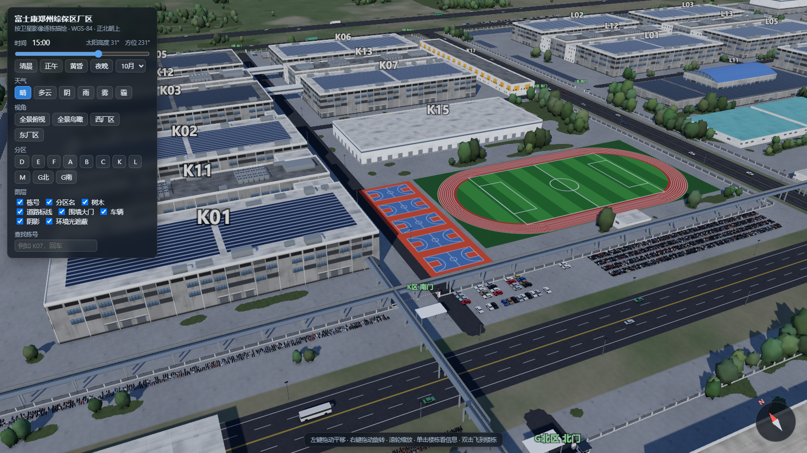

# 富士康郑州综保区厂区 3D 模型

按卫星影像逐栋描绘的厂区 3D 模型和离线查看器。所有坐标是真实经纬度（WGS-84）。



## 怎么看

下载仓库后双击 `富士康厂区3D/index.html`，用 Chrome 或 Edge 打开。不需要联网，不需要安装。
操作方法和已知不足见 `富士康厂区3D/使用说明.txt`。

## 内容

- 11 个分区：D、E、F、A、B、C、K、L、M、G北、G南
- 113 栋带栋号的主楼、199 个附属建筑、19 条楼间物料输送连廊、15 段沿路管廊
- 道路、田径场、球场、约 8600 棵树（位置取自卫星图）
- 围墙约 20 公里、46 个大门和入口、约 900 辆停放轿车、约 1 万辆电动车
- 时间滑块（按郑州经纬度算太阳位置）、6 种天气、夜景

## 目录

| 路径 | 内容 |
| --- | --- |
| `富士康厂区3D/` | 成品：`index.html` + 打包好的 `app.js` |
| `tools/trace_data.py` | 手工描的全部数据（楼栋、道路、围墙、大门、车位），改这里的数字即可改模型 |
| `tools/` | 数据管线：卫星瓦片拼图、转正裁片、导出、叠合检查、无头截图 |
| `src/` | 查看器源码（three.js 0.172，esbuild 打包） |
| `data/campus.geojson` | 带经纬度的台账 |
| `docs/交接与进度.md` | 做法、进度、已知问题 |
| `docs/check/` | 成品截图和叠回卫星图的核对图 |

## 重新生成

```
cd tools
python build_mosaic.py google 19     # 只在需要重新描图或重新识别树木时才要，下载约 140 MB 瓦片
python export.py
cd ../src
npm install
node build.mjs
```

`export.py` 要读卫星拼图（识别绿地和树），所以改了 `trace_data.py` 后需要先有拼图。只改查看器代码、不改数据的话，仓库里已带导出结果 `src/data/`，直接 `node build.mjs` 即可。

## 没有放进仓库的

- 原始资料（各区地图截图、App 平面图、实拍照片）
- 卫星瓦片拼图 `data/ortho/`
- 旧版工程

## 精度说明

- 楼栋平面位置误差约 1–3 米；楼高是按层数估算的，没有实测值。
- 立面、围墙、大门是统一的通用样式，不是逐栋照实物做的。
- 围墙线是按绿化带内沿、管廊线和硬化场地边界推定的，卫星图上看不到栏杆本身。
